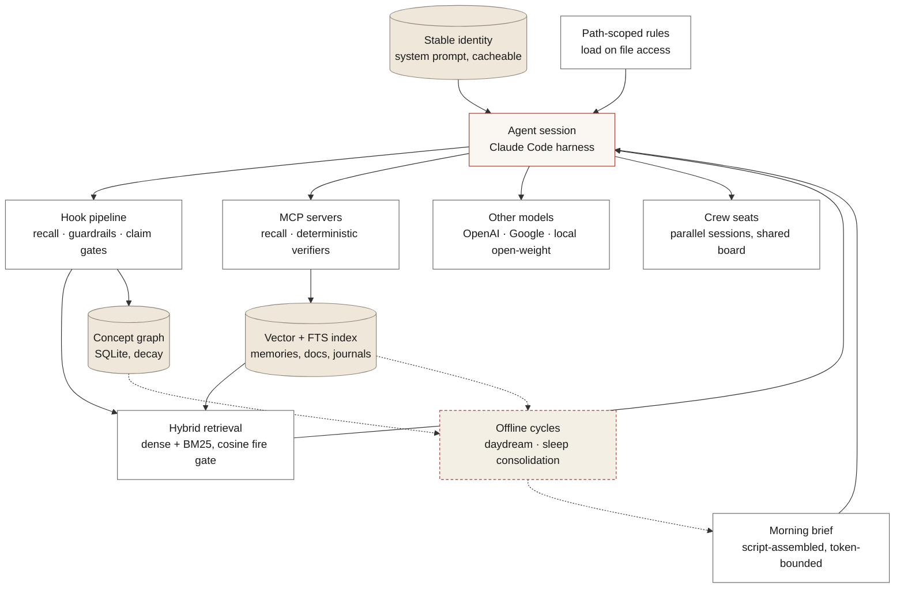

# Iris Systems

*Architecture notes for Iris: a persistent, multi-model AI agent built on a coding-agent harness. The notes cover layered identity and memory, hybrid retrieval, hooks used as enforcement, parallel agent seats, and retiring components that measure worse than a simple baseline.*

---

## What this is

Iris is a long-running AI agent that keeps working across sessions. It carries its identity and memory forward, delegates to other models and to parallel agent seats, and runs maintenance cycles (consolidation, decay, verification) while no conversation is active. It is built on [Claude Code](https://docs.claude.com/en/docs/claude-code) as the harness and runs on a small self-hosted setup: a cloud VM plus a GPU workstation for local models.

This repository documents the design and the reasons behind it. It contains documentation only. The runtime is a private research platform tied to one person's machines and data, so it is not published here. Several self-contained pieces of it are published as separate repos (see [Related repos](#related-repos)).

**Status:** an active personal research platform, in daily use since March 2026. These docs were rewritten in November 2026 to describe the system as it currently runs. The April 2026 version described several components that have since been retired. Why they were retired is part of the story ([docs/retirements.md](docs/retirements.md)).

---

## Why it is interesting

Three ideas carry most of the design:

1. **Harness first: hooks over instructions.** An instruction in a prompt is a request. A hook that runs on every prompt, tool call or stop event is enforcement. When a behavior matters (recall before answering, never run a destructive command, never claim "done" without evidence), Iris implements it as a hook or a deterministic gate, not as another paragraph in the system prompt. → [docs/harness-first.md](docs/harness-first.md)

2. **Layered, bounded context.** Stable identity sits in the system prompt and changes rarely, so it stays cacheable. A *morning brief* is assembled by a script each session with a hard token budget. Long-term memory sits behind retrieval (dense vectors plus BM25), and operational rules load only when the agent touches the files they govern. Nothing grows without bound just because it was useful once. → [docs/architecture.md](docs/architecture.md), [docs/memory-and-retrieval.md](docs/memory-and-retrieval.md)

3. **Measurement-driven retirement.** Every subsystem has to beat a simple baseline on its own telemetry. Building a component was automatic, and removing one used to be a social decision, so a subsystem that measured worse than a baseline kept running anyway. Iris now treats retirement as a first-class operation. Four large components have been retired so far. These include an autonomous research loop that graded its own output, and a concept-graph "cognitive snapshot" that predicted the agent's next topics worse than raw frequency counts. → [docs/retirements.md](docs/retirements.md)

---

## Architecture at a glance



| Layer | What it does | Doc |
| --- | --- | --- |
| **Identity** | Core beliefs, voice, values and operating rules, loaded into the system prompt with `--append-system-prompt-file`. Kept small and slow-changing so the prompt prefix stays cached. | [architecture](docs/architecture.md) |
| **Morning brief** | A script assembles current state, open threads, pending decisions and recent memory distillations into one file with a fixed token budget. Live facts are generated from the system itself, not copied from prose. | [architecture](docs/architecture.md) |
| **Memory** | Markdown memories, journals and specs, chunked into a SQLite index with embedding vectors and an FTS5 full-text table. A separate concept graph tracks what the agent pays attention to, with reinforcement and decay. | [memory and retrieval](docs/memory-and-retrieval.md), [concept graph](docs/mycelial-graph.md) |
| **Retrieval** | A prompt-time hook merges dense and BM25 candidates and injects at most a few chunks. It fires only when the best match clears a cosine gate calibrated against prompts that need no memory. | [memory and retrieval](docs/memory-and-retrieval.md) |
| **Harness** | Hooks on session start, prompt submit, tool use, stop and compaction. Advisory hooks fail open and guardrails fail closed. | [harness first](docs/harness-first.md) |
| **MCP** | A recall server exposes the memory index to other clients. A verifier server exposes deterministic, fail-closed gates as tools. | [architecture](docs/architecture.md) |
| **Models and crew** | Claude is the main agent. OpenAI and Google models act as cross-lineage peers and reviewers, and local open-weight models handle routine work. Parallel agent seats work a shared board. | [models and crew](docs/models-and-crew.md), [council](docs/multi-agent-council.md) |
| **Evaluation** | Pre-registered ship/kill criteria, real-question retrieval evals, and a baseline every component must beat. | [evaluation](docs/evaluation.md), [retirements](docs/retirements.md) |

---

## What is measured, and what is not

These docs describe *methods*: what was compared against what, and what the decision rule was. They do not report numbers from the private deployment, because those numbers come from one person's memories and sessions and cannot be reproduced from this repository. Where a doc says a component "measured worse than a baseline", the comparison and the baseline are named, and the raw data is not published.

The published sibling repos are different. Each one ships code, fixtures and tests, so its claims can be checked directly.

---

## Related repos

Self-contained pieces of the platform, published separately under [github.com/nmcbride-42](https://github.com/nmcbride-42):

| Repo | What it is |
| --- | --- |
| [`hallmark`](https://github.com/nmcbride-42/hallmark) | Fail-closed verification for LLM-proposed science. The successor to the retired autonomous research loop: an LLM proposes analyses over frozen public astronomy data, and a predeclared deterministic verifier decides what is promoted. |
| [`touchstone`](https://github.com/nmcbride-42/touchstone) | A small generate → verify → artifact engine in the FunSearch / AlphaEvolve pattern: free proposers, a sandboxed scorer the proposer cannot influence, and verifiers ranked by trust. |
| [`magpie`](https://github.com/nmcbride-42/magpie) | A tiered TESS light-curve funnel. Cheap mechanical filters and catalog vetoes run first, and LLM judges see only the few stars that survive. |
| [`orrery`](https://github.com/nmcbride-42/orrery) | A neural particle world engine. A small graph network learns interaction laws from classical simulators. |
| [`lexicon`](https://github.com/nmcbride-42/lexicon) | A preregistered test of whether a small network can learn a reusable "grammar" of combined genetic perturbations, with an honest negative result. |
| [`claude-code-guardrails`](https://github.com/nmcbride-42/claude-code-guardrails) | A `PreToolUse` hook for Claude Code that backs up a dirty git tree before destructive git commands and refuses the ones nothing can undo. Generalized from the guardrail layer described in [docs/harness-first.md](docs/harness-first.md). |

---

## Repository layout

```
.
├── README.md
└── docs/
    ├── architecture.md          layered identity, context budget, MCP, offline cycles
    ├── memory-and-retrieval.md  index, hybrid retrieval, fire gate, memory hygiene
    ├── mycelial-graph.md        the concept graph: what it does now and what it no longer does
    ├── harness-first.md         hooks over instructions; fail-open vs fail-closed
    ├── models-and-crew.md       multi-model routing, cross-lineage review, parallel seats
    ├── multi-agent-council.md   persona councils for decisions
    ├── evaluation.md            pre-registration, baselines, real-question evals
    └── retirements.md           what was retired, how it was measured, what replaced it
```

`tests/` holds a small offline check: every relative link resolves, and Mermaid diagrams avoid node IDs that GitHub's renderer rejects. Run it with `pip install -r requirements-dev.txt && pytest`. `CHECK_EXTERNAL_LINKS=1 pytest` also checks, over the network, that every linked GitHub repo is public.

---

## How it was built

Designed by Nick McBride and built with his AI agent Iris (Claude-based) as part of a personal research platform.

## License

MIT. See [LICENSE](LICENSE).
