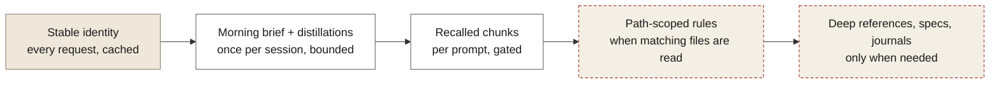
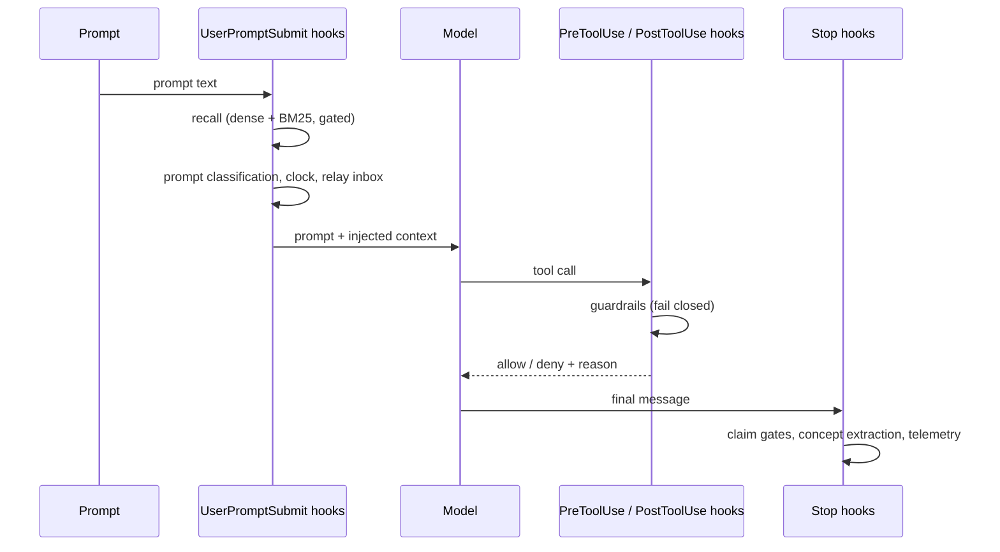

# Architecture

How one session of Iris is put together: what loads into context and when, what fires around each turn, and what runs while no session is open.

---

## Design constraints

Every layer is shaped by three constraints.

- **The context window is working memory, not storage.** Anything loaded on every turn costs tokens and attention on every turn. So the always-loaded layers are small and bounded, and everything else is retrieved or loaded on demand.
- **The system prompt prefix is a cache.** Prompt caching only pays off if the prefix stays the same. Content that changes weekly does not belong in it, however important it is.
- **Prose drifts and generated state does not.** A hand-written description of the system goes stale silently and then reads as authoritative. Where a fact can be generated from the running system (which flags are on, which hooks are registered, which services exist), it is generated.

---

## What loads, and when

| Layer | Loaded | Size discipline | Contents |
| --- | --- | --- | --- |
| **Stable identity** | Every request, through `--append-system-prompt-file` | Small and slow-changing, so the cache prefix holds | Core beliefs, voice, values, morals, operating rules, and a generated capability manifest |
| **Morning brief** | Once, at session start | Hard token budget (roughly 5k) enforced by the assembler | Needs, last-session warm start and open threads, current state, pending decisions, recent highlights, and live facts generated from the system |
| **Memory distillations** | Once, at session start | Roughly 2k tokens | One-line summaries of core memories and recent long-term memories, plus titles of older ones. Everything older goes through recall. |
| **Recalled chunks** | Per prompt, from a hook | A few chunks under a token cap, and only when the fire gate passes | Relevant memories, specs, journal passages |
| **Path-scoped rules** | When the agent reads or edits files under a matching path | Each rule is short and scoped | Operational detail: how to query the concept graph, the hook pipeline, memory discipline, long-running job rules |
| **Deep references** | On demand | Unbounded on disk, never auto-loaded | Full capability descriptions, build docs, specs, journals |

### Why the capability list moved out of stable identity

An earlier version kept a long hand-written capability list in the system prompt. It grew to most of the stable payload and changed weekly, which broke the prompt cache. Worse, it went stale without anyone noticing: it described the retrieval pipeline wrongly for weeks while reading as the authoritative source. It was replaced by a **generated manifest**. A script reads live configuration (enabled retrieval flags, registered MCP servers, running services, installed skills) and writes the manifest, so it cannot drift from the running system. The long-form list still exists on disk as an on-demand reference.

### Warm start vs cold start

- **Resume.** The context is intact, so the session simply continues.
- **Warm start** (after a short break). The brief includes a warm-start note written at the end of the previous session, covering tone, momentum and open threads.
- **Cold start** (after a sleep cycle). The brief carries the factual state, and the agent reads the latest consolidation log to see what the offline cycle found.

A `SessionStart` hook re-injects identity reminders on startup, on resume *and after context compaction*. Without it, the compacted summary would silently drop who the agent is.

---

## Around each turn

- **Before the model runs**, prompt-submit hooks run retrieval and inject the result as additional context ([memory-and-retrieval.md](memory-and-retrieval.md)), along with small amounts of situational context.
- **Around every tool call**, guardrail hooks block destructive or out-of-scope operations, and post-tool hooks keep indexes fresh and record telemetry ([harness-first.md](harness-first.md)).
- **When the model stops**, claim gates check the final message. A completion claim with no evidence, an "X is down" claim with no probe this session, or an unsupported world-knowledge claim each triggers a reminder before the human acts on it. Concept extraction updates the concept graph asynchronously.

---

## MCP servers

Two in-house [Model Context Protocol](https://modelcontextprotocol.io) servers make the platform usable from outside a single Claude Code session:

- **Recall server.** It exposes the memory index as tools: vector recall, offline BM25 keyword recall, a compact context pack (who the agent is, what is in flight, open decisions), a validator for memory writes, and an asynchronous "ask the agent" call. Any MCP client can then read the same memory, including other models' coding tools and chat apps. Memory stops being locked to one harness.
- **Verifier server.** It exposes deterministic, fail-closed gates as tools: the star-catalogue verifier from [`hallmark`](https://github.com/nmcbride-42/hallmark), the sandboxed scorer from [`touchstone`](https://github.com/nmcbride-42/touchstone), and others. A gate returns pass or fail from code and has no LLM in the decision. Any model can propose, but only a gate can promote.

Third-party MCP servers cover current library documentation and web search.

---

## Offline cycles

Some work happens when no session is running.

| Cycle | Trigger | LLM? | What it does |
| --- | --- | --- | --- |
| **Daemon heartbeat** | Scheduled tasks | Mostly no | Index drains, memory dedup sweeps, health checks, small scheduled jobs |
| **Daydream** | Gated on activity and idle time | No | Walks the concept graph for coherence checks and pattern observations, and writes a log the next session can read |
| **Sleep consolidation** | Nightly | Yes | Reads recent sessions, consolidates working notes into long-term memory, retires superseded memories (marking them invalid from a point in time rather than deleting them), applies decay, and writes a dream log. The next cold start reads this log. |

Each consolidation step runs under its own time budget and error isolation, so one slow or failing pass cannot starve the others.

---

## Storage and services

| Store | Tech | Contents |
| --- | --- | --- |
| Memory index | SQLite: chunk table, FTS5 table, stored embedding vectors with a memory-mapped dense cache | Chunks of memories, journals, specs, rules and build docs |
| Concept graph | SQLite | Concept nodes, weighted connections, activation and decay logs ([mycelial-graph.md](mycelial-graph.md)) |
| Identity and memory | Markdown in git | Identity files, long-term and core memories, journals |
| Work tracking | A small board service | Stories, claims and notes for the parallel crew ([models-and-crew.md](models-and-crew.md)) |

Services are Python, run as systemd units. Embeddings come from a locally served open-weight embedding model behind a small loopback service, so a single copy of the model is shared by every caller. Local generation models run on a GPU workstation behind an OpenAI-compatible router. The deployment is deliberately small: owning every layer makes its failure modes visible, and those failure modes are what this research studies.
