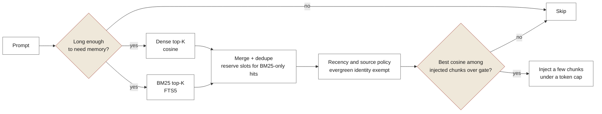

# Memory and Retrieval

How Iris stores what it knows, and how the right few pieces reach the model on a given prompt.

---

## What gets indexed

Memory is plain Markdown under git: core and long-term memories, short typed memory notes, journals and dream logs, specs, operational rules and build docs. Plain files keep it diffable and reviewable, and the agent itself can edit it. An indexer chunks these files into a SQLite store:

| Table | Purpose |
| --- | --- |
| `document_chunks` | Chunk text, source path, chunker version, timestamps and supersession state |
| FTS5 virtual table | BM25 full-text search over chunk content, kept in sync by triggers |
| Stored vectors | One embedding per chunk. A memory-mapped dense matrix gives fast cosine search, with a verify-and-refill step when the index changes. |

Test code and generated files are excluded. A coverage command reports which source files have no chunks, because a memory that was never indexed cannot be recalled.

---

## The prompt-time recall hook

1. **Short prompts skip.** Acknowledgements and one-line replies never reach retrieval.
2. **Two candidate channels.** Dense cosine search catches paraphrase. BM25 catches what bi-encoders miss: proper nouns, file paths, identifiers and exact phrases. A few slots in the candidate window are reserved for chunks found only by BM25, so the dense top-K cannot crowd them out.
3. **Merged order ranks.** Candidates are ranked by their merged position, then adjusted for recency and source type. Identity and core memory are exempt from recency decay, so an old but foundational statement is not buried by recent chatter. Archive files are down-weighted as history.
4. **A fire gate decides whether to inject anything at all.** Retrieval injects only when the best dense cosine among the chunks it is about to inject clears a threshold. A chunk found only by BM25 has its cosine computed from its stored vector and cannot open the gate on keyword overlap alone.
5. **Bounded injection.** A small number of chunks under a token cap, delivered as additional context.

The hook has a latency budget. A retrieval that would blow the budget is dropped rather than delaying the turn.

### How the gate was set

The threshold was calibrated on two sets: real questions whose answer is in memory, and real prompts that need no memory at all. The chosen value trades a little recall on the first set for fewer spurious injections on the second. The calibration table lives next to the constant in code. To change the constant, re-run the eval first.

### Why there is no cross-encoder in the hot path

The original design reranked the merged candidates with a hosted cross-encoder. When that was swapped for a small local cross-encoder, a real-question eval showed the local reranker was *weaker than the merged order it was asked to improve*: in most of the regressions, it had pushed an already well-ranked gold document out of the top results. A blend of the two scored slightly higher but used most of the latency budget, and the difference came down to one or two questions. So the merged order ranks and the cross-encoder is off. A flag turns it back on for re-measurement with a stronger model. This is the same retirement rule as [retirements.md](retirements.md), applied at small scale.

---

## The graph channels, and why they are off

Early versions blended in two graph-derived channels: concept-overlap ("sparse") candidates, and multi-hop spreading activation from concept nodes to memories. An evaluation over genuine queries, with a fair merge so the graph candidates actually reached ranking, found that the graph channels changed essentially none of the fire decisions. They almost never supplied the top result that dense retrieval would have missed. Both channels are now behind flags that are off by default, kept for re-measurement rather than deleted. The concept graph still exists, for a different job ([mycelial-graph.md](mycelial-graph.md)).

---

## Memory hygiene

Retrieval quality depends on what is in the index as much as on ranking.

- **Supersession, not deletion.** A nightly pass compares new memory-shaped chunks with older ones and separates "the world moved on" from "the old belief was wrong". The first case marks the older chunk invalid from a point in time (bitemporal retirement, no penalty). The second records a negative reinforcement event. Superseded memories remain retrievable as history.
- **Paraphrase dedup.** An embedding-based sweep clusters near-duplicate memory notes and moves duplicates to a recoverable eviction folder, with a tombstone in the index. It defaults to a dry run.
- **Write-time guard.** The memory-write tool collapses exact rewrites, so it does not mint a new numbered copy of the same note.
- **Chunker versioning.** Each chunk records the chunker version that produced it. A re-chunk can then roll out as hygiene without silently invalidating judgments made against the older text.
- **Promptware scan.** Every injected memory passes a pattern scan for prompt-injection shapes (role impersonation, fake fences, exfiltration language) before it reaches context. A match is flagged so the model treats the text as untrusted.

---

## Evaluation

Retrieval changes are judged against a **real-question benchmark**: questions taken from actual use, each paired with the document that answers it. The metrics are hit@1, hit@3 and MRR over the full pipeline, run through the same code path the hook uses, plus a set of prompts that should not fire. Some probes pit an old statement against its explicit revision: the revision must rank higher, and the old one must stay retrievable. See [evaluation.md](evaluation.md).
