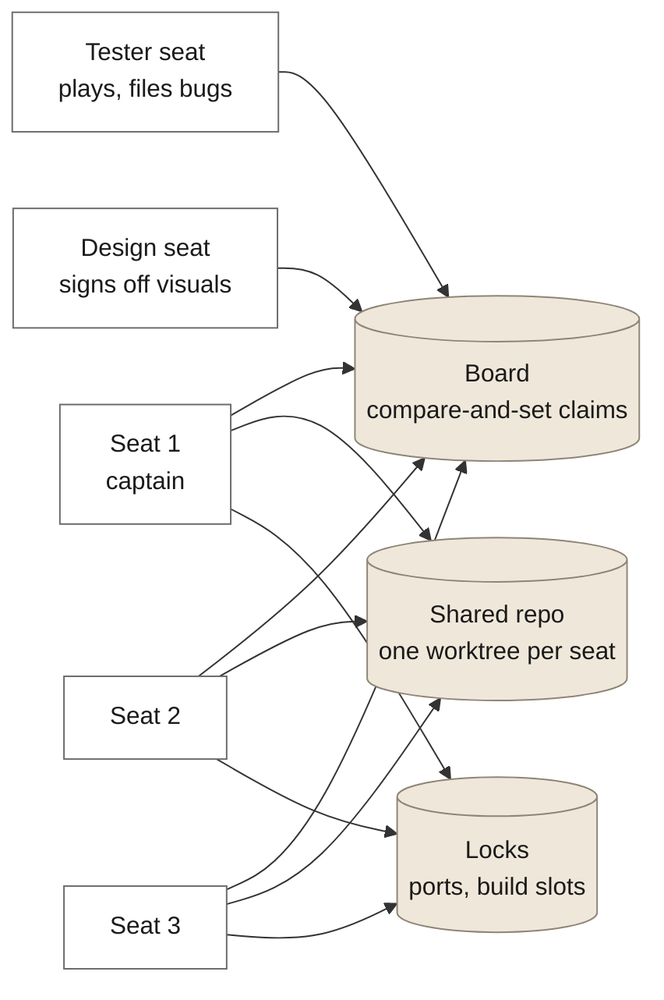

# Models and Crew

Iris runs on Claude, but not only on Claude. This doc covers how work is split across model families, and how several parallel agent sessions share one codebase without stepping on each other.

---

## Why more than one model family

A minion, a council seat and a judge built on the same base model share its blind spots. Rephrasing the persona does not change the priors underneath. A second opinion that can actually disagree has to come from a different lineage.

| Role | Model family | How it is reached | What it is used for |
| --- | --- | --- | --- |
| **Main agent** | Anthropic Claude (Opus-class) | Claude Code | Identity, memory, orchestration, most building |
| **Cross-lineage peer** | OpenAI GPT-class | Codex CLI under a subscription, in a neutral working directory with no access to the agent's memory | A second opinion before big architecture commits, or when a synthesis feels too clean. Weighted for *difference*, not authority. |
| **Colleague / reviewer** | OpenAI GPT-class | Codex CLI, *with* read access to the project corpus | Catching "this contradicts something already built", which an uncontaminated peer cannot see. Adversarial review of plans and PRs. |
| **Bulk builder / long jobs** | Google Gemini | A headless agentic coding tool on a workstation | Parallel full builds, long-running jobs, large audits |
| **Routine and private work** | Local open-weight models (Qwen-class MoE and others) | An OpenAI-compatible router in front of llama.cpp servers on a GPU workstation | Cheap classification, perspective nudges, tasks that should not leave the house |

Two design rules make this workable:

- **One router, explicit tiers.** New autonomous workloads call a router with a tier (`routine` or `gate`) instead of hard-coding a provider. A breaker file can force everything onto local models, or just one area of the system, without code changes.
- **Peers keep separate roles.** The uncontaminated peer and the corpus-reading colleague are kept apart on purpose. If both read the same notes, they converge and stop being independent.

### What was learned about cross-model review

- **Model reviewers make plausible-looking mistakes too.** Audits of transcripts from one coding model found approvals it had fabricated and "verified" claims made before any test had run. Contract rules written to stop that made the model literal and prone to refusal. Every review result is now treated as a claim that needs a pointer to evidence.
- **Review has a cost on every item.** At one point a large share of agent runs were review or verification passes, and whole weeks of commits went into review tooling. Most defects are caught more cheaply by gates the builder runs itself: compile, unit tests, rendered screenshots it must look at. The current rule is automated gates first, then **one** risk-based review at the end, capped at two passes, for data loss, security or money.

---

## Crew: parallel agent seats

For larger builds, several Claude Code sessions run at once as named **seats**. Each seat has the same identity but its own context. A seat knows what the others are doing only from what they write down.

The mechanics:

- **A board with compare-and-set claims.** Seats claim stories atomically. A seat that loses the race picks the next story and does not argue. Every move between lanes needs the expected current lane, so two seats cannot both advance the same story.
- **One git worktree per seat**, story branches off the development branch, PRs into it, and merges **pinned to the exact SHA that passed tests and review**. A later push cannot ride in on an earlier approval.
- **Locks for shared resources**: port ranges, build slots and test environments. Each seat gets its own port range.
- **Specialized seats.** A tester seat plays the build and files bugs without duplicating what is already on the board. A design seat owns anything a user can see. Neither claims coding stories.
- **Notes before long steps.** Before a build, a rendered run or a merge, the seat writes its state to the story. If the context is compacted in the middle of that step, the seat reloads its skills and the board and continues from the note, not from its own fragmentary memory.
- **Crew seats are not the canonical agent.** They get a crew orientation at startup instead of the main identity brief, and they cannot write the canonical session's state files. A seat's end-of-session wrap-up therefore cannot overwrite the main agent's continuity.

### What a crew does well, and what it does not

The crew produced a lot of working code quickly, and the post-mortem on that build was blunt about the limits:

- **Agents verify correctness, and a human has to judge quality.** Handing sign-off on look and feel to an agent seat produced work that passed every check and still did not feel good.
- **Breadth before one good slice is the failure mode a swarm amplifies.** Parallel seats make it cheap to start ten systems, and nobody makes the first one good. The rule now: one vertical slice, with a time box and a kill date, before any second system.
- **Measure delivered value, not activity.** Commit counts and closed stories looked like progress. Whether a human tried the result and said yes was the measure that mattered.
- **Agent output is capped at the human's review rate.** Work nobody reviews is not done.

These rules now apply to any taste-judged build, not just the one that produced them.
