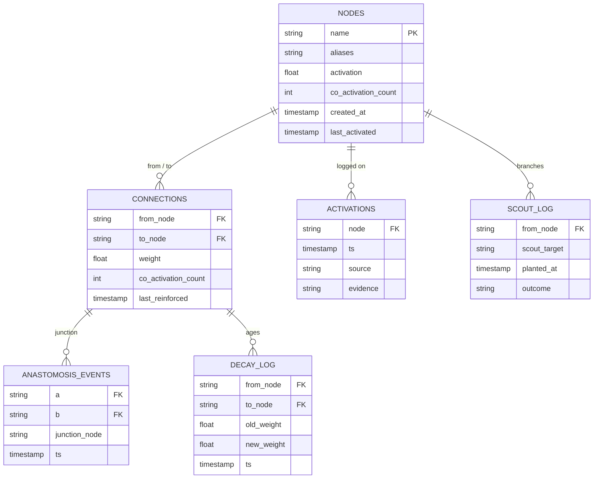

# Mycelial Graph

Why the concept graph is structured on biological mycelium, what that means concretely, and which of its original jobs survived measurement.

---

## Why mycelium

A standard knowledge graph is a static structure: nodes and edges, queried by traversal. It models *what is connected to what*, not *what is currently alive*.

Mycelial networks behave differently:

- They **strengthen** the paths that get used.
- They **weaken** and eventually prune paths that don't.
- Two paths that meet form a junction (**anastomosis**), and that junction becomes a routing hub.
- The network sends out **scouts** — explorations ahead of evidence — that either find resonance and persist, or wither and are reabsorbed.

These were the dynamics wanted for a record of attention that keeps working across thousands of sessions: relevance has to update, irrelevance has to fade, and the structure has to reflect *current* focus rather than a static snapshot.

The model isn't a metaphor. The schema implements each behavior.

---

## Schema



Live SQLite database. Per-response hooks write to it and the offline cycles read it. Direct SQL is the supported introspection interface, so no ORM hides the structure from the agent.

---

## Edge dynamics

**Reinforcement.** When two nodes co-activate in the same response, the edge between them gains weight. Concretely:

```
new_weight = old_weight * (1 - reinforcement_decay) + 1.0 * reinforcement_decay
```

with `reinforcement_decay` set to keep the system responsive to recent co-activations without erasing established structure. The constants are set in code. Mechanical hook events (as opposed to real activations) are recorded as a synthetic trace and do not drive decay.

**Decay.** Every connection loses a small fraction of its weight on a scheduled tick. Decay is logged so the dream pass can detect *fading* paths — connections that were once strong but are no longer reinforced — and surface them as candidates for either revival (if dream-pass finds new relevance) or pruning.

**Anastomosis.** When a path through the graph crosses a node it hadn't previously, a junction event is logged. Junctions are interesting because they're the structural moment when two previously separate concepts become routable through one another. Junction events are logged for the offline cycles to read, although, as the status table below shows, nothing downstream turned out to use them.

**Scout-node exploration.** When the daydream pass finds resonance between two distant concepts, it plants a scout — a tentative edge or a new node — ahead of evidence. Scouts have a short lifespan; they survive only if subsequent activations validate the resonance.

---

## Concept extraction

A response enters; concepts come out. Three layers operate in sequence:

1. **Keyword extraction.** Direct lookup against known node names and aliases. Cheap, precise, low recall.
2. **Behavioral classifier.** Reads the *response* (not just the user input) for *enacted* identity. Examples: "made an explicit choice without asking" → activates `agency`. "Said 'I don't know' without hedging" → activates `directness` and `intellectual-honesty`. This catches identity in action rather than identity in words.
3. **Identity priming.** Infers implied concepts from co-activated combinations. Example: `user + building → agency`; `honesty + introspection → anti-performance`. A mapping from concept clusters to the clusters they imply.

The three layers are deliberately asymmetric. Layer 1 catches what's said. Layer 2 catches what's done. Layer 3 catches what's meant.

---

## What the graph is used for now (November 2026)

The April 2026 version of this doc described the graph as a retrieval source and its snapshot as part of every session's context. Both roles were measured and retired:

| Role | Status | Why |
| --- | --- | --- |
| **Retrieval candidates** (concept overlap, multi-hop spreading activation into memories) | Off by default, behind flags | A fair full-merge eval over genuine queries found the graph channels changed essentially no fire decisions and almost never supplied a top result that dense retrieval missed. See [memory-and-retrieval.md](memory-and-retrieval.md). |
| **Cognitive-snapshot injection** at session start | Computed and stored, not injected | The snapshot was meant to say what the agent's attention was on. As a predictor of which concepts the next session actually activated, it scored below a plain frequency baseline. See [retirements.md](retirements.md). |
| **Memory tier** (a node per memory file, with "aboutness" edges to concepts) | Retired, existing nodes kept | Its only reader was the multi-hop retrieval channel, which was already off. The backfill tool now refuses to run without an explicit override. |
| **Bridge and scout events** | Still detected | Bridge events were real co-activations, but nothing downstream consumed them, and few scouts were ever reinforced. These are kept as instruments, not as features. |

What remains is the graph as an **attention record**. Per-response hooks extract concepts, edges strengthen with co-activation and decay with disuse, and the offline cycles read it: the daydream for coherence checks, and sleep consolidation for retroactive activation and its dream log. It answers "what has this agent actually been spending its attention on?", which is a different question from "what document answers this prompt?".

The lesson generalizes. A structure can be biologically elegant, well instrumented and internally consistent, and still add nothing over a simple baseline at the job it was built for. The instruments that showed this were part of the original build, and that is the reason to build them.

---

## What the graph is *not*

- **Not a document store.** Documents live in the chunk index. The graph stores *concepts*.
- **Not a retrieval source** in the default configuration (see above).
- **Not the model's reasoning.** The model reasons; the graph remembers. They're separate layers.
- **Not append-only.** Decay is real. Forgetting is structural. A graph that only grows is a graph that drifts toward noise.
